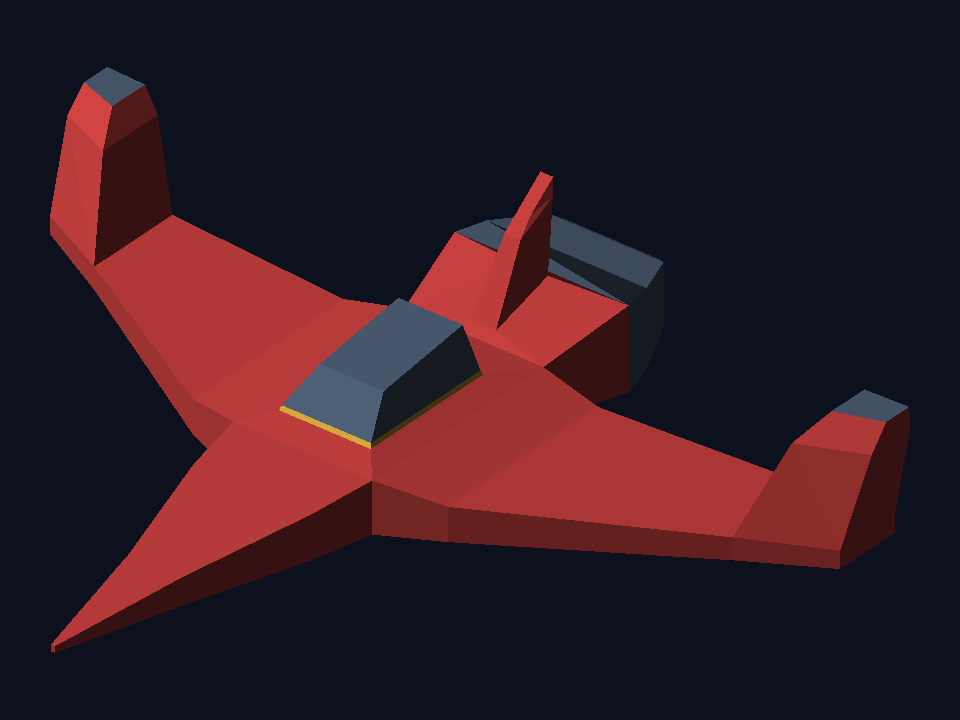

# Nave CB Renderer

Proyecto en C++17 que carga una malla OBJ y rasteriza sus caras triangulares en CPU dentro de un framebuffer propio. SDL2 presenta ese framebuffer en una ventana; el modo `--render` guarda los mismos píxeles como PNG sin abrir ventana.



## Dependencias y compilación en Windows

- CMake 3.16 o posterior.
- Un compilador C++17, por ejemplo Visual Studio 2022 con la carga **Desarrollo para el escritorio con C++**.
- SDL2 para la ventana. Una forma de instalarla es con [vcpkg](https://learn.microsoft.com/vcpkg/): `vcpkg install sdl2:x64-windows`.

SDL2 se instala con vcpkg. Si todavía no tenés vcpkg, seguí su [guía oficial para Windows](https://learn.microsoft.com/en-us/vcpkg/get_started/get-started-vs/), ejecutá `bootstrap-vcpkg.bat` y luego instalá el paquete:

```powershell
vcpkg install sdl2:x64-windows
```

Desde PowerShell, en la carpeta `nave_cb_renderer`, configurá y compilá con la ruta de vcpkg:

```powershell
cmake -S . -B build\sdl2 -G "Visual Studio 17 2022" -A x64 -DCMAKE_TOOLCHAIN_FILE="$env:LOCALAPPDATA/vcpkg/scripts/buildsystems/vcpkg.cmake"
cmake --build build\sdl2 --config Release
& .\build\sdl2\Release\nave_renderer.exe
```

Sin SDL2 el proyecto compila en modo sin ventana; `--render` sigue generando la imagen. Con SDL2, la ventana se cierra con `Esc` o con el botón de cierre.

Para crear el PNG desde el framebuffer (también funciona sin SDL2):

```powershell
& .\build\sdl2\Release\nave_renderer.exe --render
```

El programa espera `assets/nave.obj` relativo al directorio de ejecución. Se pueden indicar rutas explícitas: `nave_renderer.exe --render assets/nave.obj docs/render.png`.

## Cómo funciona

El lector propio procesa líneas `v`, `f` y `usemtl`. En cada referencia de cara toma el componente anterior a `/`, admite `v`, `v/vt/vn`, `v//vn`, índices OBJ positivos desde 1 e índices negativos relativos al final de la lista. Los convierte a índices C++ desde 0 y valida que apunten a un vértice existente. Para este archivo las 196 caras son triangulares.

`render()` recorre explícitamente las caras; obtiene los tres vértices por sus índices y llama a `triangle()`. La proyección ortográfica usa una cámara elevada en tres cuartos. Se proyectan todos los vértices primero para obtener la caja completa, luego se calcula una escala uniforme y un desplazamiento central dejando 50 píxeles de margen. El rasterizador recorta el rectángulo de cada triángulo a la pantalla, calcula coordenadas baricéntricas y usa un z-buffer por píxel. La paleta se asigna según `Rojo`, `Gris_oscuro` y `Amarillo`, sin cargar MTL.

## Controles

- Ventana: cerrar con el botón de cierre o presionar `Esc`.
- Modo PNG: `--render` genera `docs/render.png` y termina.

## Estado de verificación

Se inspeccionó el OBJ de origen: contiene 100 vértices y 196 caras. El archivo original está en la carpeta padre; `assets/nave.obj` es una copia idéntica. El modo `--render` se compiló con MSVC 19.44/C++17, se ejecutó y reportó esas cantidades; `docs/render.png` se generó con el framebuffer del programa y se verificó visualmente centrada y dentro de los límites. SDL2 2.32.10 se instaló mediante vcpkg y la configuración interactiva se compiló correctamente con Visual Studio 2022.


